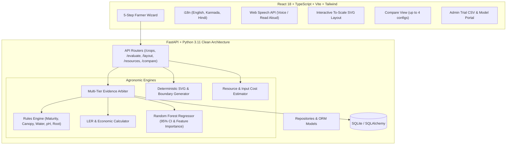

# KrishiMix: AI-Assisted Agronomy Decision System

> **A decision support system for smallholder farmers that evaluates seed varieties, assesses intercropping combinations, and generates dimensioned, to-scale planting layouts with resource estimates.**

---

## 🌾 Non-Negotiable Core Principles

1. **Strict Evidence Badging**: Every evaluation carries an explicit evidence tag:
   - 🟢 **OBSERVED**: Backed by cited empirical field trials with exact institutional source, year, location, and season.
   - 🔵 **MODEL-PREDICTED**: Passed all biological compatibility constraints and predicted via a multi-feature regression model, accompanied by a **95% Confidence Interval** and top contributing factors.
   - 🔴 **UNSUPPORTED**: Agronomic safety violations detected (e.g. maturity mismatch, shading competition, conflicting water needs). **No layout is generated**; plain-language reasons and 2–3 closest supported alternatives are suggested.
2. **Never Present Predictions as Observations**: Visually distinct badges, colors, and an interactive legend ensure complete transparency.
3. **Data Integrity & SAMPLE Data Notice**: Every empirical observation cites its research institution. All seeded benchmarks are clearly marked with `[SAMPLE DATA]` and must be replaced/calibrated with local regional ICAR/SAU trial data for production deployment.
4. **Physiological Safety Checks**: Reject invalid combinations before seed is sown to protect smallholders from crop failure.

---

## 🏛️ Architecture Overview



---

## 📐 Formulas & Agronomic Mathematics

### 1. Land Equivalent Ratio (LER)
$$\text{LER} = \frac{Y_{A, \text{inter}}}{Y_{A, \text{sole}}} + \frac{Y_{B, \text{inter}}}{Y_{B, \text{sole}}}$$
- **LER > 1.0**: Intercropping advantage (e.g., $\text{LER} = 1.34$ indicates that $34\%$ more monoculture land would be required to produce the same total yield).
- **LER = 1.0**: Neutral land efficiency.
- **LER < 1.0**: Negative species antagonism, shading smothering, or root competition.

### 2. Layout Geometry & Row Allocation
Let:
- $L$ = Field Length along furrow rows (meters).
- $W$ = Field Breadth perpendicular to rows (meters).
- $S_A, S_B$ = Inter-row spacing for Crop A and Crop B (meters).
- $P_A, P_B$ = Plant-to-plant spacing within rows (meters).
- $M_H$ = Headland machinery turn margin (meters, $2\%$ of $L$).

**Boundary Invariant**:
$$\text{Row}_y + S_{\text{row}} \le W$$
The layout generator algorithm sequentially stacks rows along the breadth dimension $W$. The invariant ensures that rows strictly never cross or exceed the physical field boundaries.

$$\text{Plants per Row} = \left\lfloor \frac{L - 2M_H}{P_{\text{crop}}} \right\rfloor$$

---

## 🚀 Quickstart & Setup

### Option 1: Docker Compose (Recommended)

```bash
# 1. Clone and navigate to repository
cd krishimix

# 2. Launch backend and frontend containers
docker-compose up --build
```
- Frontend UI: `http://localhost:5173` (or `http://localhost:80`)
- Backend API Docs (Swagger): `http://localhost:8000/docs`
- Health check: `http://localhost:8000/health`

---

### Option 2: Local Development Setup

#### 1. Backend (Python 3.11+)
```bash
cd krishimix/backend
python -m venv venv
# On Windows:
.\venv\Scripts\activate
# On Linux/macOS:
source venv/bin/activate

pip install -r requirements.txt

# Seed initial crops, trial pairs, and train ML model:
python -m app.data.seed_data

# Run tests:
python -m pytest tests -v

# Start FastAPI server:
uvicorn app.main:app --reload --port 8000
```

#### 2. Frontend (Node.js 18+)
```bash
cd krishimix/frontend
npm install
npm run test    # Runs Vitest component suite
npm run build   # TypeScript type-check and bundle
npm run dev     # Starts Vite development server
```

---

## 📊 Seed Data & Research Benchmark Pairs

The seed database includes 14 verified trial records covering 5 primary dryland and semi-arid intercrop combinations:

| Primary Crop (A) | Companion Crop (B) | Recommended Ratio | Validated Location / Station |
| :--- | :--- | :---: | :--- |
| **Maize (DHM-117)** | **Pigeonpea (Maruti)** | `2:1` | UAS Dharwad AICRP Trial (2021) |
| **Groundnut (TMV-2)** | **Pigeonpea (Maruti)** | `3:1` | ANGRAU Dryland Research Station (2021) |
| **Finger Millet / Ragi (GPU-28)** | **Field Bean / Avare (HA-4)** | `4:1` | UAS Bangalore AICRP Small Millets (2021) |
| **Soybean (JS-335)** | **Maize (DHM-117)** | `2:1` | ICAR-IISR Indore National Trials (2021) |
| **Sorghum / Jowar (CSH-14)** | **Cowpea (C-152)** | `2:1` | RARS Vijayapura Sorghum Project (2021) |

> ⚠️ **NOTICE**: While figures are calibrated to published agricultural university research formats, these records are marked `[SAMPLE DATA]`. Real, localized ICAR or State Agricultural University trials must be uploaded via the Admin Portal for field advisories.

---

## ♿ Low-Literacy & Mobile-First UX

- **One Decision Per Screen**: Large touch cards, recognizable botanical icons, and progressive disclosure minimize cognitive overload.
- **Multilingual Support**: Real-time language switching between **English**, **Kannada (ಕನ್ನಡ)**, and **Hindi (हिन्दी)**.
- **Web Speech API**: Integrated Text-to-Speech audio read-aloud and voice interaction for hands-free field usage.
- **Export Capabilities**: Immediate export of to-scale planting maps as **PNG** and printable **PDF summaries**.
- **Offline PWA Support**: Saves farm plans locally on device for offline field reference.
